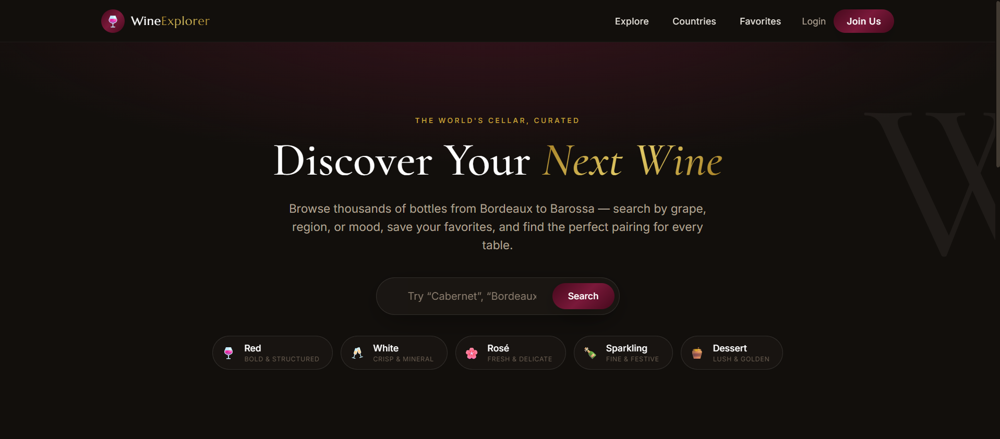
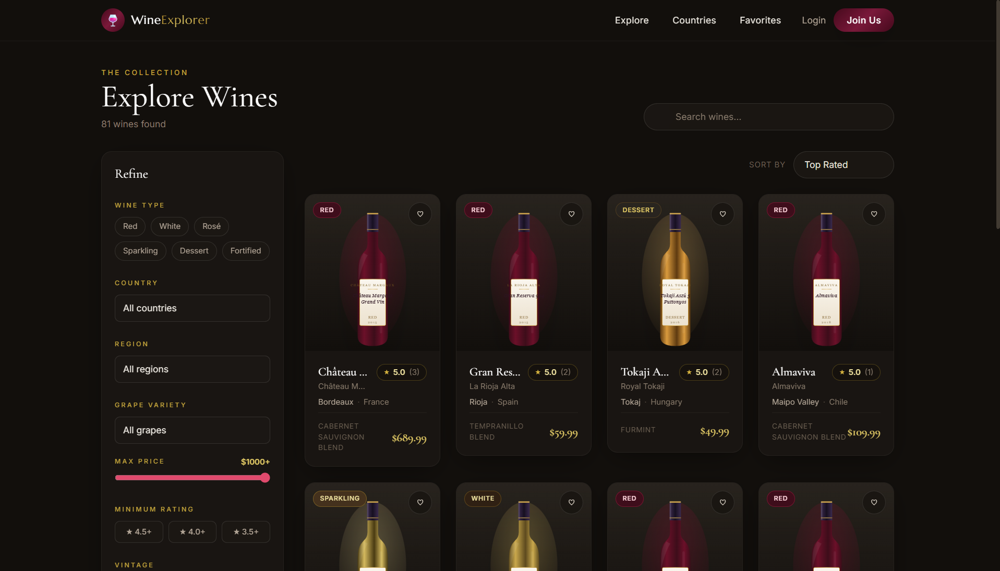
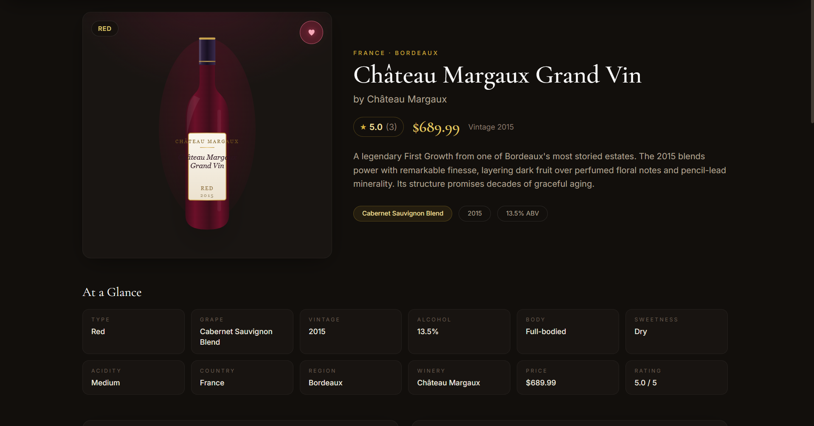
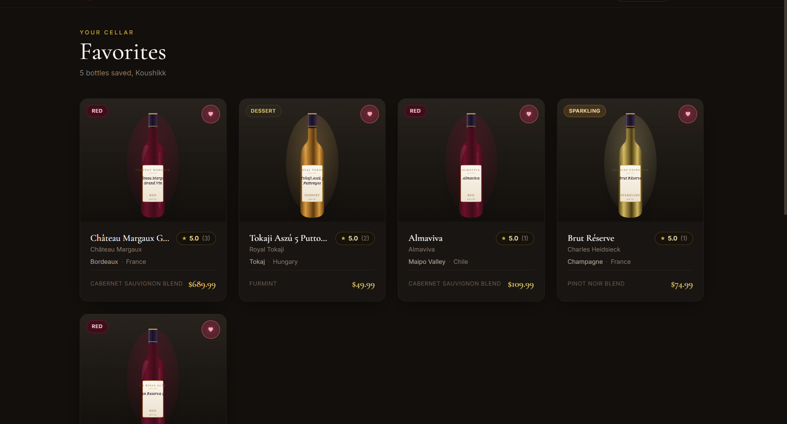
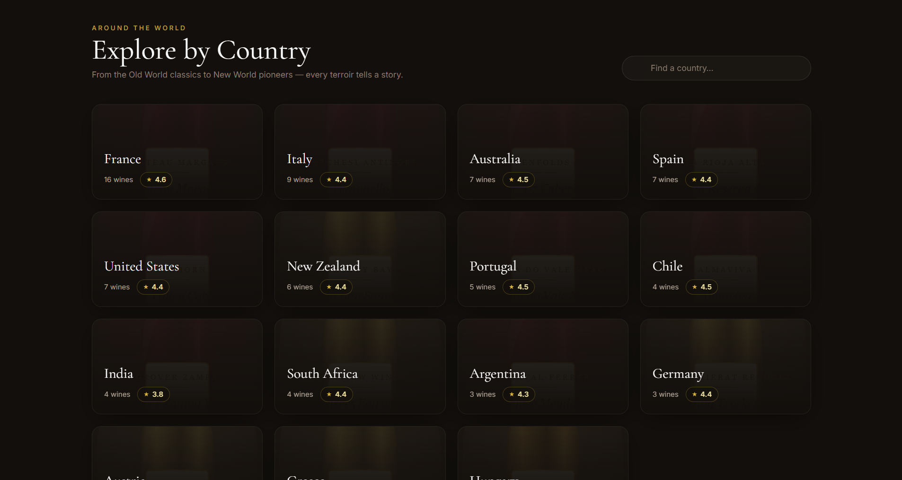
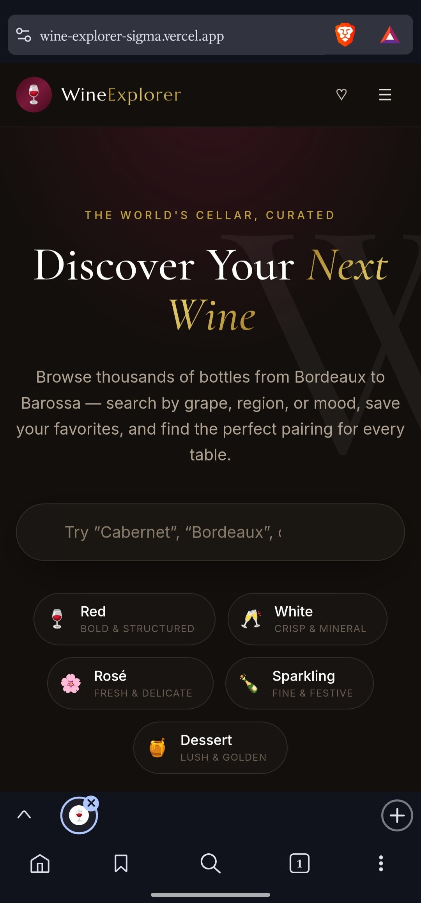

# 🍷 Wine Explorer


A premium full-stack wine discovery platform. Browse, search, and filter 80+ real wines from 15 countries, explore them by region and grape, save favorites to your personal cellar, and rate and review the bottles you've tasted.

Built as a portfolio-grade showcase of a complete product: a React single-page application talking to a REST API backed by MongoDB — with real authentication, real persistence, and a polished, responsive luxury UI.

---

## 📖 Table of Contents

- [Description](#-description)
- [Features](#-features)
- [Screenshots](#-screenshots)
- [Technology Stack](#-technology-stack)
- [Architecture](#-architecture)
- [Folder Structure](#-folder-structure)
- [Getting Started](#-getting-started)
  - [Prerequisites](#prerequisites)
  - [MongoDB Setup](#mongodb-setup)
  - [Backend Setup](#backend-setup)
  - [Frontend Setup](#frontend-setup)
  - [Environment Variables](#environment-variables)
  - [Database Seeding](#database-seeding)
  - [Running the App](#running-the-app)
- [API Documentation](#-api-documentation)
- [Authentication](#-authentication)
- [Favorites](#-favorites)
- [Reviews & Ratings](#-reviews--ratings)
- [Future Improvements](#-future-improvements)
- [GitHub Usage](#-github-usage)
- [License](#-license)

---

## 📝 Description

Wine Explorer lets users discover wine the way a sommelier would — by country, region, grape variety, body, sweetness, and price. The catalog is served entirely from a MongoDB database through an Express REST API; the frontend contains **no hardcoded wine data**. Every search, filter, sort, and page of results is a live database query.

Signing up unlocks a personal layer on top of the catalog: favorites sync to your account and survive refreshes, and your 1–5 star reviews feed directly into each wine's average rating.

The interface follows a dark, modern-luxury aesthetic — deep cellar tones, burgundy accents, champagne-gold highlights, serif display typography, frosted-glass panels, and subtle motion throughout.

---

## ✨ Features

**Discovery**
- 🔍 **Full-text search** across wine name, winery, grape, country, region, type, and description — served by the backend
- 🧰 **Combinable filters** — wine type, country, region, grape variety, price range, minimum rating, vintage, body, and sweetness, all applied server-side and reflected in the URL
- ↕️ **Sorting** — top rated, name, price (both directions), newest
- 📄 **Pagination** with URL-synced page state
- 🌍 **Country explorer** — aggregated country cards with wine counts and average ratings
- 🍇 **Grape varieties** — popular grapes with counts, linking into filtered results
- 🍾 **Wine detail pages** — full profile, tasting notes, food pairings, reviews, and "You may also like" recommendations

**Accounts**
- 🔐 Register, login, logout with JWT-based sessions and bcrypt password hashing
- ❤️ **Favorites** — one-tap heart with optimistic UI; persisted per account in MongoDB
- ⭐ **Reviews** — one review per user per wine, with edit/delete and live average-rating recalculation
- 👤 **Profile page** — member stats, favorite wines, and review history

**Experience**
- 📱 Fully responsive — mobile filter drawer, hamburger navigation, adaptive card grids
- ⏳ Loading skeletons, empty states, and error states with retry on every data surface
- 🎞️ Subtle, professional motion — page transitions, card hovers, heart-burst animation, image fade-ins
- 🖼️ SVG bottle art generated per wine (type-tinted, personalized labels) so the catalog looks curated with zero external assets

---

## 📸 Screenshots

> Place screenshots in `docs/screenshots/` and they will render here.

| Home | Explore |
| --- | --- |
|  |  |

| Wine Details | Favorites |
| --- | --- |
|  |  |

| Countries | Mobile |
| --- | --- |
|  |  |

*Suggested captures: home hero, explore with filters open, a wine detail page with reviews, the favorites page, the countries grid, and a mobile viewport showing the filter drawer.*

---

## 🛠 Technology Stack

| Layer | Technology | Notes |
| --- | --- | --- |
| Frontend | React 19, Vite 8 | SPA with animated route transitions |
| Styling | Tailwind CSS 3 | Custom `ink` / `wine` / `gold` design system |
| Routing | React Router 7 | URL-synced filter state, protected routes |
| HTTP | Axios | Central API service layer with token injection |
| Animation | Framer Motion | Page transitions and card motion |
| Backend | Node.js, Express 5 | REST API, layered controllers/routes/middleware |
| Database | MongoDB, Mongoose 8 | Schema validation, indexes, aggregations |
| Auth | JSON Web Tokens, bcryptjs | Stateless auth, 12-round password hashing |
| Security | Helmet, CORS, express.json limits | Hardened headers and allow-listed origins |
| Tooling | Nodemon, dotenv | Dev server and configuration |

---

## 🏗 Architecture

```
┌─────────────────────────┐         ┌──────────────────────────┐         ┌──────────────┐
│      React SPA          │  HTTP   │       Express API        │  Mongo   │   MongoDB    │
│  (Vite dev server)      │ ──────► │                          │ ──────► │              │
│                         │  JSON   │  routes → controllers    │ Mongoose│    wines     │
│  pages/                 │ ◄────── │      → models            │ ◄────── │    users     │
│  components/            │         │      → middleware        │         │   reviews    │
│  context/ (auth, favs)  │         │  (auth, errors, async)   │         │              │
│  services/api.js        │         └──────────────────────────┘         └──────────────┘
└─────────────────────────┘
```

**Request lifecycle (example: filtered explore query)**

1. The Explore page keeps filter/sort/page state in the URL (`/explore?type=Red&country=France&page=2`)
2. `services/api.js` sends `GET /api/wines?type=Red&country=France&page=2` with the JWT attached (if present)
3. The wine controller builds a Mongo query from a **whitelist** of filter params, with regex search and range filters
4. Mongoose runs the query against text and compound indexes; results + total count return in one round trip
5. The controller responds with a consistent envelope `{ success, count, total, page, pages, data }`
6. The frontend renders a responsive card grid with skeletons while loading and error/empty states on failure

**Auth flow**

```
Register/Login ──► bcrypt compare ──► sign JWT (7d) ──► client stores token
Request ──► Authorization: Bearer <token> ──► protect middleware verifies ──► req.user
```

**Data model relationships**

```
User 1───* Review *───1 Wine
User *───* Wine   (favorites — array of Wine refs on User)
```

Wine documents denormalize `rating` and `numReviews`, recalculated from the reviews collection whenever a review is created, edited, or deleted.

---

## 📁 Folder Structure

```
wine-explorer/
├── backend/
│   ├── config/
│   │   └── db.js                  # MongoDB connection
│   ├── controllers/
│   │   ├── wineController.js      # list/search/filter/CRUD
│   │   ├── countryController.js   # country + grape aggregations
│   │   ├── authController.js      # register / login / me
│   │   ├── favoriteController.js  # add / remove / list
│   │   └── reviewController.js    # CRUD + ownership checks
│   ├── middleware/
│   │   ├── auth.js                # protect, optionalAuth (JWT)
│   │   ├── errorHandler.js        # normalized JSON errors
│   │   ├── notFound.js            # 404 handler
│   │   ├── asyncHandler.js        # async error propagation
│   │   └── ApiError.js            # typed HTTP errors
│   ├── models/
│   │   ├── Wine.js                # schema, indexes, recalcRating()
│   │   ├── User.js                # schema, bcrypt hooks
│   │   └── Review.js              # schema, unique (user, wine)
│   ├── routes/                    # wine, auth, favorite, review, country
│   ├── scripts/
│   │   ├── seed.js                # idempotent seeder (npm run seed)
│   │   ├── seedWines1.js          # seed data: France, Italy, Spain, Portugal
│   │   ├── seedWines2.js          # seed data: 11 more countries
│   │   └── wineArt.js             # SVG bottle-art generator
│   ├── server.js                  # app entry
│   └── .env.example
├── frontend/
│   ├── src/
│   │   ├── components/
│   │   │   ├── wines/             # WineCard, WineGrid, SearchBar, FilterPanel,
│   │   │   │                      # WineDetails, ReviewCard, ReviewForm
│   │   │   ├── countries/         # CountryCard
│   │   │   └── ui/                # Rating, FavoriteButton, BottleImage,
│   │   │                          # LoadingSpinner, EmptyState, ErrorMessage,
│   │   │                          # Pagination
│   │   ├── context/
│   │   │   ├── AuthContext.jsx    # session bootstrap, login/register/logout
│   │   │   └── FavoritesContext.jsx
│   │   ├── pages/                 # Home, Explore, WineDetails, Countries,
│   │   │                          # CountryWines, Favorites, Login, Register,
│   │   │                          # Profile, NotFound
│   │   ├── services/
│   │   │   └── api.js             # axios layer: wines, auth, favorites,
│   │   │                          # reviews, countries
│   │   ├── hooks/                 # (reserved for future shared hooks)
│   │   ├── App.jsx                # router + layout + transitions
│   │   ├── main.jsx               # providers
│   │   └── index.css              # Tailwind layers + design utilities
│   ├── tailwind.config.js         # design tokens
│   ├── vite.config.js
│   └── .env.example
├── docs/screenshots/              # README screenshots
├── .gitignore
└── README.md
```

---

## 🚀 Getting Started

### Prerequisites

| Tool | Version | Check |
| --- | --- | --- |
| Node.js | 20.19+ (tested on 24) | `node --version` |
| npm | 10+ | `npm --version` |
| MongoDB | 7+ (local, Docker, or Atlas) | see below |
| Git | any recent | `git --version` |

### MongoDB Setup

**Option A — Docker (recommended, fastest):**

```bash
docker run -d --name wine-explorer-mongo -p 27017:27017 -v wine-explorer-mongo-data:/data/db mongo:7
```

Later, start/stop it with `docker start wine-explorer-mongo` / `docker stop wine-explorer-mongo`.

**Option B — Local install:** install MongoDB Community Server for your OS and make sure it is listening on `mongodb://localhost:27017`.

**Option C — MongoDB Atlas:** create a free cluster, add a database user, whitelist your IP, and copy the connection string into `MONGO_URI` (see [Environment Variables](#environment-variables)).

### Backend Setup

```bash
# 1. Clone the repository
git clone https://github.com/<your-username>/wine-explorer.git
cd wine-explorer/backend

# 2. Install dependencies
npm install

# 3. Create your environment file
cp .env.example .env
#    → set MONGO_URI and generate a fresh JWT_SECRET (see below)

# 4. Seed the database (81 wines + demo users + reviews)
npm run seed

# 5. Start the API
npm run dev        # development, auto-reload → http://localhost:5000
# or
npm start          # production mode
```

Verify it's alive:

```bash
curl http://localhost:5000/api/health
# {"success":true,"message":"Wine Explorer API is running"}
```

### Frontend Setup

```bash
# From the project root
cd wine-explorer/frontend

# 1. Install dependencies
npm install

# 2. Create your environment file
cp .env.example .env
#    → defaults point at http://localhost:5000/api

# 3. Start the dev server
npm run dev        # → http://localhost:5173
```

Open **http://localhost:5173** — the app is now talking to the API and database.

> Demo accounts are created by the seed script for quick exploration; their credentials are defined in `backend/scripts/seed.js` and surfaced on the login page. Register a fresh account for a clean cellar.

### Environment Variables

Both apps read configuration from `.env` files. **Never commit real `.env` files** — only the `.env.example` templates are versioned. Generate a strong secret with:

```bash
node -e "console.log(require('crypto').randomBytes(32).toString('hex'))"
```

**`backend/.env`**

| Variable | Required | Description | Example |
| --- | --- | --- | --- |
| `NODE_ENV` | – | Environment | `development` |
| `PORT` | ✔ | API port | `5000` |
| `MONGO_URI` | ✔ | MongoDB connection string | `mongodb://localhost:27017/wine-explorer` |
| `JWT_SECRET` | ✔ | Secret used to sign tokens — **keep private** | `<long-random-string>` |
| `JWT_EXPIRE` | – | Token lifetime | `7d` |
| `CLIENT_URL` | ✔ | Allowed CORS origin(s), comma-separated | `http://localhost:5173` |

**`frontend/.env`**

| Variable | Required | Description | Example |
| --- | --- | --- | --- |
| `VITE_API_URL` | ✔ | Base URL of the backend API | `http://localhost:5000/api` |

> In production, `MONGO_URI` and `JWT_SECRET` should come from your host's secret manager — never from the repo. The frontend's `VITE_API_URL` is public by nature; no secrets belong there.

### Database Seeding

```bash
cd backend
npm run seed            # upserts wines, demo users, reviews, favorites
npm run seed:destroy    # wipes wines, users, and reviews
```

The seeder is **idempotent**: wines upsert on a unique `{ name, winery }` index, reviews upsert per `(user, wine)`, and demo users are created only if missing — so re-running never creates duplicates and never clobbers accounts created through the app. Wine ratings are recalculated from reviews at the end of every run.

The catalog spans **15 countries** (France, Italy, Spain, Portugal, Germany, Austria, United States, Australia, Argentina, Chile, South Africa, New Zealand, India, Hungary, Greece) across **6 types** (Red, White, Rosé, Sparkling, Dessert, Fortified), each record with a full description, tasting notes, food pairings, and generated bottle art.

### Running the App

| Task | Command | URL |
| --- | --- | --- |
| Run backend (dev) | `cd backend && npm run dev` | http://localhost:5000 |
| Run backend (prod) | `cd backend && npm start` | http://localhost:5000 |
| Run frontend (dev) | `cd frontend && npm run dev` | http://localhost:5173 |
| Build frontend | `cd frontend && npm run build` | outputs `dist/` |
| Preview build | `cd frontend && npm run preview` | http://localhost:4173 |
| Seed database | `cd backend && npm run seed` | — |

For development, run both servers in separate terminals. The frontend proxies nothing — it calls the API directly at `VITE_API_URL`, which must be allow-listed in the backend's `CLIENT_URL`.

---

## 🔌 API Documentation

Base URL: `http://localhost:5000/api`

Every response uses a consistent envelope. Success: `{ success: true, ... }`. Failure: `{ success: false, error: "<human-readable message>" }` with a meaningful status code — `400` validation, `401` unauthenticated, `403` forbidden (not your resource), `404` not found, `409` conflict (duplicate).

Protected endpoints require the header `Authorization: Bearer <token>`.

### Wines

| Method | Endpoint | Auth | Description |
| --- | --- | --- | --- |
| `GET` | `/wines` | – | List wines — search, filters, sort, pagination |
| `GET` | `/wines/search?q=term` | – | Dedicated search endpoint (max 24 results) |
| `GET` | `/wines/meta/options` | – | Distinct countries/regions/grapes/vintages for filter UI |
| `GET` | `/wines/:id` | – | Single wine by id |
| `POST` | `/wines` | ✅ | Create a wine |
| `PUT` | `/wines/:id` | ✅ | Update a wine |
| `DELETE` | `/wines/:id` | ✅ | Delete a wine |

**`GET /wines` query parameters** — all combinable, all applied server-side:

| Param | Example | Notes |
| --- | --- | --- |
| `search` | `?search=cabernet` | Matches name, winery, grape, country, region, type, description |
| `type` | `?type=Red` | `Red` `White` `Rosé` `Sparkling` `Dessert` `Fortified` |
| `country` | `?country=France` | Exact match |
| `region` | `?region=Bordeaux` | Exact match |
| `grape` | `?grape=Pinot Noir` | Exact match |
| `minPrice` / `maxPrice` | `?minPrice=20&maxPrice=100` | Range |
| `minRating` | `?minRating=4` | Inclusive minimum |
| `vintage` | `?vintage=2016` | Exact match |
| `body` | `?body=Full-bodied` | `Light-` `Medium-` `Full-bodied` |
| `sweetness` | `?sweetness=Dry` | `Bone Dry` → `Very Sweet` |
| `sort` | `?sort=rating` | `rating` (default) `name` `price` `priceDesc` `newest` |
| `page` / `limit` | `?page=2&limit=12` | Limit capped at 60 |

Paginated response shape:

```json
{
  "success": true,
  "count": 12,
  "total": 81,
  "page": 1,
  "pages": 7,
  "data": [ { "wine": "document" } ]
}
```

### Authentication

| Method | Endpoint | Auth | Body | Returns |
| --- | --- | --- | --- | --- |
| `POST` | `/auth/register` | – | `{ name, email, password }` | `{ token, user }` |
| `POST` | `/auth/login` | – | `{ email, password }` | `{ token, user }` |
| `GET` | `/auth/me` | ✅ | – | Current user with populated favorites |

Registration enforces minimum password length (8), unique email (`409` on conflict), and never returns the password hash. Example:

```bash
curl -X POST http://localhost:5000/api/auth/register \
  -H "Content-Type: application/json" \
  -d '{"name":"Jane Doe","email":"jane@example.com","password":"a-strong-passphrase"}'
```

### Favorites

| Method | Endpoint | Auth | Description |
| --- | --- | --- | --- |
| `GET` | `/favorites` | ✅ | The user's saved wines as full documents |
| `POST` | `/favorites/:wineId` | ✅ | Add a wine (idempotent) |
| `DELETE` | `/favorites/:wineId` | ✅ | Remove a wine |

Favorites are stored as an array of wine references on the user document. See [Favorites](#-favorites) for behavior details.

### Reviews

| Method | Endpoint | Auth | Description |
| --- | --- | --- | --- |
| `GET` | `/wines/:wineId/reviews` | – | Paginated reviews for a wine |
| `POST` | `/wines/:wineId/reviews` | ✅ | `{ rating: 1–5, comment }` — one per user per wine |
| `PUT` | `/reviews/:reviewId` | ✅ | Edit — owner only |
| `DELETE` | `/reviews/:reviewId` | ✅ | Delete — owner only |
| `GET` | `/reviews/mine` | ✅ | All of the current user's reviews |

### Countries & Grapes

| Method | Endpoint | Description |
| --- | --- | --- |
| `GET` | `/countries` | Aggregated: name, wine count, average rating, sample image |
| `GET` | `/countries/grapes` | Grape varieties with counts and average ratings |

### Health

`GET /health` → `{ "success": true, "message": "Wine Explorer API is running" }`

---

## 🔐 Authentication

- **Password storage:** hashed with bcrypt (12 salt rounds) via Mongoose pre-save hooks; hashes are `select: false` and stripped from every response
- **Tokens:** signed JWTs (HS256, configurable expiry, default 7 days) issued on register/login
- **Transport:** the frontend stores the token in `localStorage` and attaches it via an Axios request interceptor; the API is stateless
- **Route protection:** `protect` middleware guards all write endpoints, `/auth/me`, `/favorites/*`, and `/reviews/*`; expired or invalid tokens return `401` with a clear message
- **Ownership:** review edit/delete verify `review.user === req.user._id` server-side (`403` otherwise) — not just in the UI
- **CORS:** strict origin allow-list from `CLIENT_URL`; Helmet sets hardened headers
- **Validation:** schema-level validation with friendly messages, whitelisted query params, and a 10 KB JSON body cap

---

## ❤️ Favorites

- Clicking the heart on any wine card or detail page calls `POST /api/favorites/:wineId`; clicking again removes it
- The UI updates **optimistically** (instant feedback with a heart-burst animation) and rolls back if the API call fails — errors are surfaced, never silently swallowed
- Favorites are hydrated from `GET /api/favorites` on login and page load, so **state survives refreshes, sessions, and devices** — it lives in MongoDB, not localStorage
- The navbar badge and mobile heart icon reflect the live count
- Guests who click a heart are redirected to login and returned to where they were after signing in

## ⭐ Reviews & Ratings

- Authenticated users rate wines **1–5 stars** with a written note; one review per user per wine (`409` on duplicates — the UI offers "edit your review" instead)
- Reviews can be **edited or deleted** by their owner; the review form switches between create and edit modes
- Each wine's `rating` and `numReviews` are **recalculated automatically** on every create/edit/delete via an aggregation pipeline, so card badges and detail pages always reflect the community
- Wines with no community reviews keep their curated editorial rating until the first review arrives
- The profile page lists all of your reviews with jump links back to each wine

---

## 🔮 Future Improvements

The architecture is deliberately structured so these can be added without rewrites (separate service layer, normalized API envelope, reference-based schemas):

- 🤖 AI wine recommendations & an AI sommelier assistant
- ⚖️ Side-by-side wine comparison
- 🧭 Advanced wine maps by region
- 📷 Wine scanner / barcode lookup
- 📈 Price tracking and alerts
- 🛠 Admin role + dashboard for catalog management
- 👥 Wine community features (follows, lists, tasting events)
- 🔁 Refresh-token rotation and OAuth providers
- 🧪 End-to-end test suite (Playwright) and CI pipeline
- ☁️ Deployment guide (Vercel + Render/Atlas) with Docker Compose for one-command local setup

---

## 🐙 GitHub Usage

**Clone and run locally**

```bash
git clone https://github.com/<your-username>/wine-explorer.git
cd wine-explorer
# then follow Getting Started above
```

**Make it your own repo (if you cloned a template)**

```bash
rm -rf .git
git init
git add .
git commit -m "Initial commit: Wine Explorer full-stack app"
git branch -M main
git remote add origin https://github.com/<your-username>/wine-explorer.git
git push -u origin main
```

**Everyday workflow**

```bash
git checkout -b feature/my-feature    # branch per feature
# ...make changes...
git add <files>                       # stage intentionally, avoid git add -A
git commit -m "Add: concise, imperative message"
git push -u origin feature/my-feature # open a PR on GitHub
```

**House rules enforced by this repo**

- `.gitignore` keeps `node_modules/`, `dist/`, logs, and **all `.env` files** out of version control — only `.env.example` templates are committed
- No secrets, tokens, or passwords belong in commits; if one leaks, rotate it immediately
- Suggested commit style: `Add: …`, `Fix: …`, `Refactor: …` prefixes for a readable history

---

## 📄 License

Released under the [MIT License](LICENSE). Wine data is illustrative seed content for demo purposes — drink responsibly. 🍷
